# TP2 Front-End — Grupo 23

DragonByte es una aplicación de React con JavaScript y Vite que continúa el proyecto del TP1. Presenta al equipo y sus cuatro perfiles, reúne recomendaciones con búsqueda y filtros, consulta el clima de Buenos Aires e incluye arcade, desafíos, bitácora y árbol de componentes.

## Índice

- [Integrantes](#integrantes)
- [Responsabilidades](#responsabilidades)
- [Publicación](#publicación)
- [Uso de inteligencia artificial](#uso-de-inteligencia-artificial)
- [Uso de IA por integrante](#uso-de-ia-por-integrante)
- [Capturas](#capturas)
- [Requisitos](#requisitos)
- [Instalación y desarrollo](#instalación-y-desarrollo)
- [Estructura de la aplicación](#estructura-de-la-aplicación)
- [Catálogo local y filtros](#catálogo-local-y-filtros)
- [Favoritos por integrante](#favoritos-por-integrante)
- [Desafíos](#desafíos)
- [Clima de Buenos Aires](#clima-de-buenos-aires)

## Integrantes

| Integrante | Perfil de GitHub |
| --- | --- |
| Sebastián Fernández | [Fernandez-Sebastian](https://github.com/Fernandez-Sebastian) |
| Glaucia Ferreira | [glaucia1906](https://github.com/glaucia1906) |
| Ignacio Grosman | [IgnacioGrosman735](https://github.com/IgnacioGrosman735) |
| Andrea Maslucan Moreno | [andreamm-lab](https://github.com/andreamm-lab) |

## Responsabilidades

El proyecto se dividió en cuatro partes para coordinar el trabajo en equipo. Cada integrante asumió la responsabilidad de una parte, según la siguiente distribución:

| Integrante | Responsabilidades |
| --- | --- |
| Glaucia Ferreira | **Tema 1: estructura y navegación.** Preparación de la base React, configuración de rutas con React Router, layout compartido, menú lateral y estilos comunes adaptados a móviles. Árbol de componentes, consolidación del README y publicación en Vercel. |
| Ignacio Grosman | **Tema 2: portada y perfiles.** Presentación del equipo y misión, organización de los datos de integrantes en JSON, tarjetas reutilizables y desarrollo de los cuatro perfiles con sus textos, imágenes, habilidades y enlaces a GitHub. |
| Sebastián Fernández | **Tema 3: favoritos del equipo.** Organización de las recomendaciones en JSON, listado dinámico de tarjetas, búsqueda por texto, filtros combinados, mensaje sin resultados y opción para limpiar la búsqueda y los filtros. |
| Andrea Maslucan Moreno | **Tema 4: clima, bitácora y arcade.** Consulta del clima de Buenos Aires mediante Open-Meteo, presentación de mediciones con unidades y fecha, estados de carga y error con reintento. Organización y presentación de los registros del proceso del equipo en la bitácora. Desarrollo del arcade Dragon Bowling. |

## Publicación

Repositorio: [TP2_FrontEnd_Grupo_23](https://github.com/andreamm-lab/TP2_FrontEnd_Grupo_23).

Sitio publicado en Vercel: [DragonByte · TP2 Front-End · Grupo 23](https://tp-2-front-end-grupo-23.vercel.app/).

## Uso de inteligencia artificial

Se utilizaron Claude y Codex como apoyo durante el desarrollo del proyecto.

| Aplicación | Modelo | Nivel de razonamiento |
| --- | --- | --- |
| Codex | GPT-6 Astra | Medio |
| Codex | GPT-6.1 Sol | Bajo y medio |
| Claude | Opus 5.5 | Medio |

El equipo revisó y adaptó el código y las propuestas incorporadas al proyecto.

## Uso de IA por integrante

Cada integrante utilizó IA como apoyo para desarrollar sus temas y revisar el proyecto. A continuación se detallan las aplicaciones, los modelos, el esfuerzo de razonamiento y las tareas realizadas.

| Integrante | Aplicación | Modelo | Esfuerzo | Uso |
| --- | --- | --- | --- | --- |
| Ignacio Grosman | Claude Code (aplicación de escritorio de Claude, pestaña Code) | Claude Opus 5.5 (Anthropic) | Medio | Análisis de consigna, rúbrica y tareas; extracción de datos de los perfiles del TP1 y diseño de `integrantes.json`; propuesta y generación de componentes, páginas y CSS Modules de `src/modules/equipo/`; pruebas de portada y perfiles en escritorio y celular. Decisiones propias sobre los datos del JSON y los archivos a incluir para no interferir con la estructura compartida, y revisión del funcionamiento antes del commit. |
| Sebastián Fernández | Codex | GPT-6 Astra | Medio | Análisis de consigna y rúbrica para organizar el trabajo entre cuatro integrantes; ajustes visuales y verificaciones automatizadas de compilación, calidad del código y comportamiento de la interfaz en distintos tamaños de pantalla. |
| Glaucia Ferreira | Codex | GPT-6.1 Sol | Bajo y medio | **Uso:** análisis de la consigna, el reparto de tareas y la estructura del TP1; generación e integración de rutas con React Router y un layout compartido mediante `Outlet`; desarrollo del menú lateral adaptable, submenú de integrantes y página 404; construcción y actualización del árbol de componentes; revisión de conflictos de integración, organización de archivos y documentación; verificación de compilación, análisis estático y pruebas de navegación en escritorio y celular. **Decisiones y revisión propias:** definición de las opciones del menú, conservación de la identidad visual del TP1, elección de la estructura de archivos y revisión del funcionamiento y de los cambios antes del commit. |
| Andrea Maslucan Moreno | Codex | GPT-6 Astra | Medio | **Uso:** análisis de la consigna y las tareas del tema 4; generación de componentes y del servicio de consulta a Open-Meteo, con mediciones, carga, error y reintento; desarrollo de la bitácora con registros, filtros y formulario; implementación del arcade Dragon Bowling y su vinculación con la clave de la bitácora. **Decisiones y revisión propias:** selección de los contenidos de la bitácora, adaptación de las propuestas a la identidad del proyecto y revisión del funcionamiento de las secciones antes del commit. |

## Capturas

Recorrido por el [sitio publicado de DragonByte](https://tp-2-front-end-grupo-23.vercel.app/). Las capturas corresponden al TP2 y están guardadas en `docs/capturas/` en formato WebP optimizado. Hacé clic en cada imagen para verla en tamaño completo.

### Portada y equipo

La portada presenta al equipo y permite activar el poder del núcleo. **Conocer al equipo** lleva a las tarjetas; cada foto alterna entre el retrato original y su avatar, y **Ver perfil** abre la página del integrante dentro de React.

[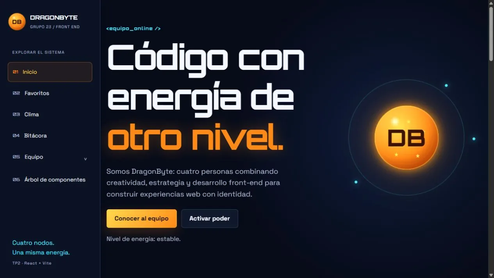](docs/capturas/inicio.webp)

<details>
<summary>Ver las tarjetas del equipo con sus avatares</summary>

[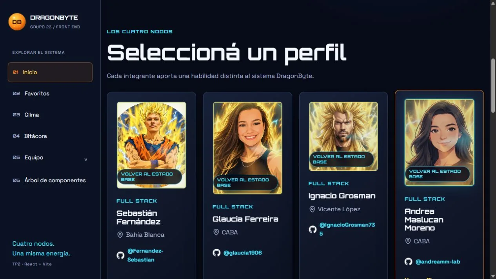](docs/capturas/equipo-avatares.webp)

</details>

### Perfiles de integrantes

Cada perfil reúne presentación, habilidades, series, películas y música. Las flechas del carrusel permiten recorrer al equipo y **Volver al equipo** regresa a la portada. Las portadas de favoritos abren contenido en YouTube y **Generar desafío** propone un reto de desarrollo.

<details>
<summary>Ver los cuatro perfiles completos</summary>

| Sebastián Fernández | Glaucia Ferreira |
| --- | --- |
| [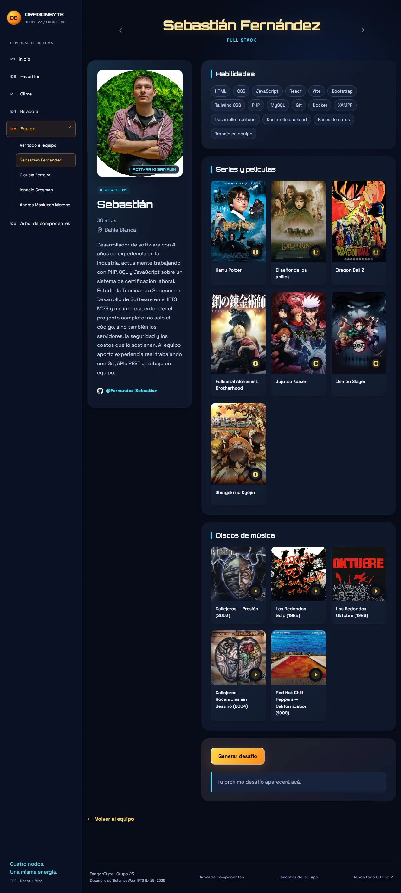](docs/capturas/perfil-sebastian.webp) | [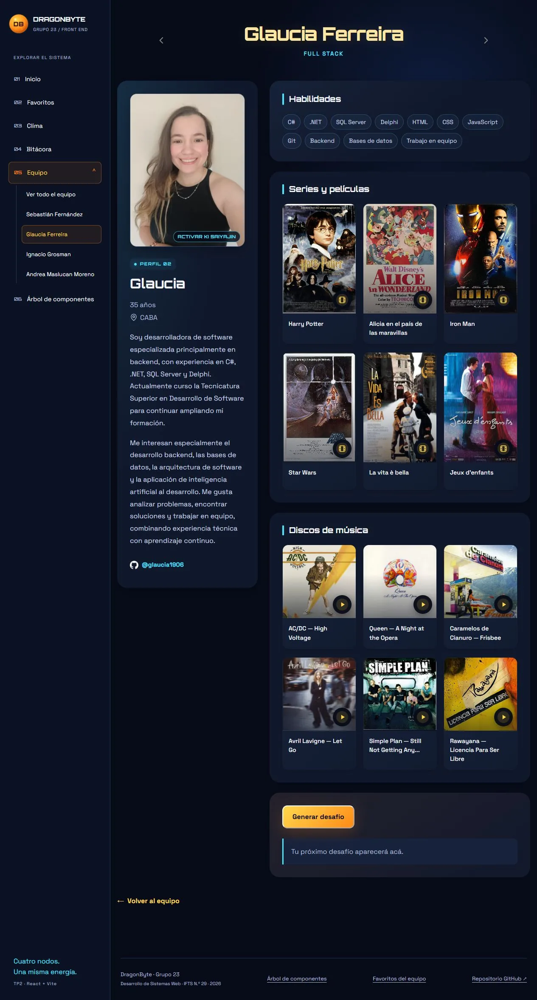](docs/capturas/perfil-glaucia.webp) |

| Ignacio Grosman | Andrea Maslucan Moreno |
| --- | --- |
| [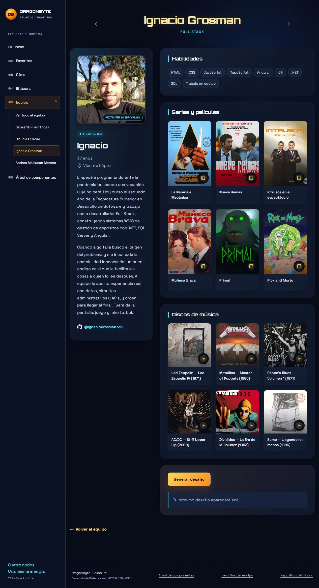](docs/capturas/perfil-ignacio.webp) | [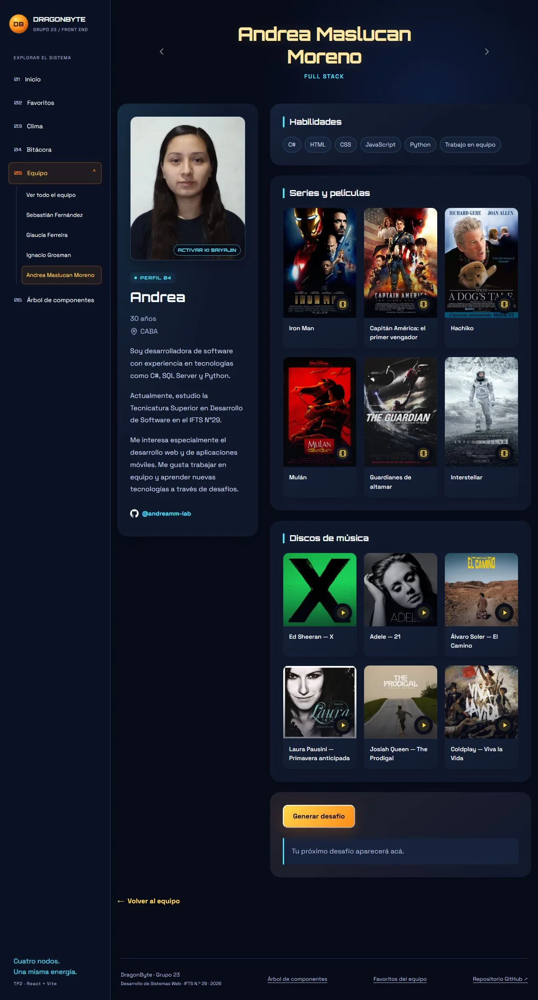](docs/capturas/perfil-andrea.webp) |

</details>

### Favoritos del equipo

El catálogo reúne 48 recomendaciones. Permite buscar por título y combinar los filtros de categoría e integrante. **Limpiar filtros** restablece el listado completo.

[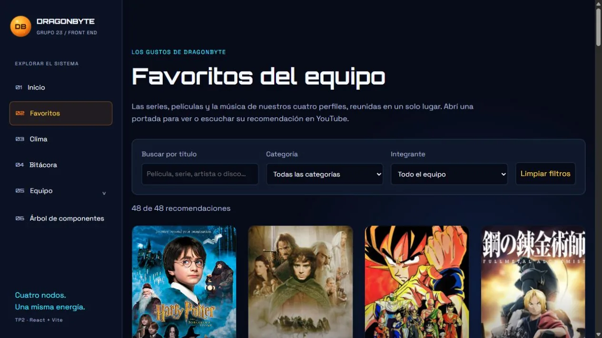](docs/capturas/favoritos.webp)

### Clima de Buenos Aires

La sección consulta Open-Meteo y muestra temperatura, sensación térmica, viento y fecha de actualización. Informa los estados de carga y error, con una opción para reintentar.

[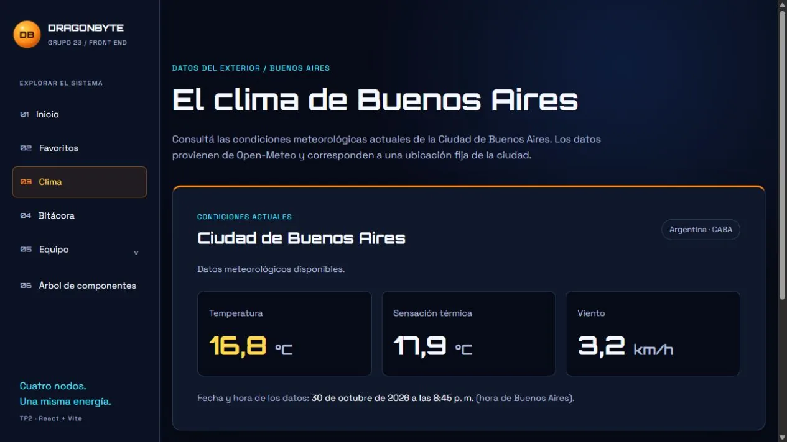](docs/capturas/clima.webp)

### Árbol de componentes

El árbol representa la jerarquía real de la aplicación. Seleccioná una rama para expandir o contraer sus componentes.

[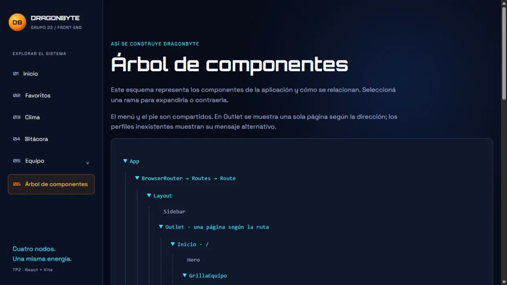](docs/capturas/arbol-componentes.webp)

### Arcade Dragon Bowling

Desde la portada, **Empezar partida** inicia el desafío de derribar diez palos en un máximo de tres lanzamientos. **Ayuda** explica los controles; ganar permite obtener la clave de demostración para agregar entradas a la bitácora.

[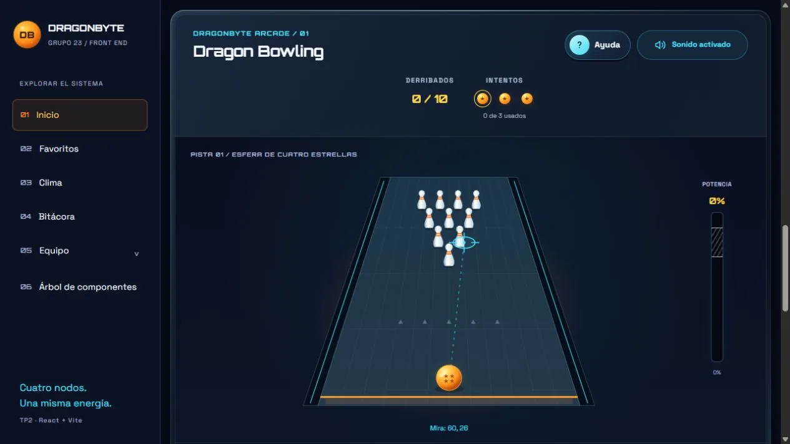](docs/capturas/arcade.webp)

### Bitácora del proyecto

La bitácora registra avances, decisiones, desafíos y soluciones. Permite filtrar por fecha, cambiar el orden y alternar entre lista y tarjetas. Las capturas muestran la parte inicial de ambas vistas.

<details>
<summary>Ver bitácora en vista de lista</summary>

[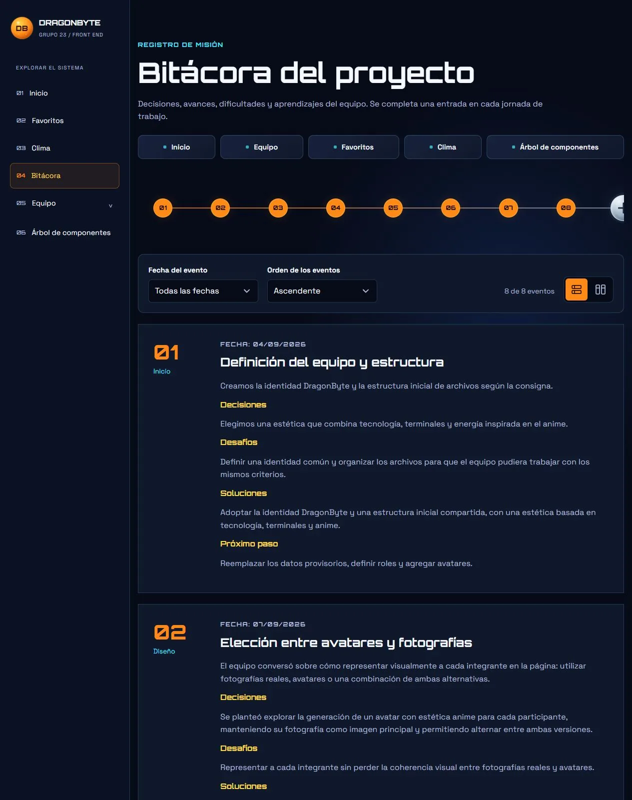](docs/capturas/bitacora-lista.webp)

</details>

<details>
<summary>Ver bitácora en vista de tarjetas</summary>

[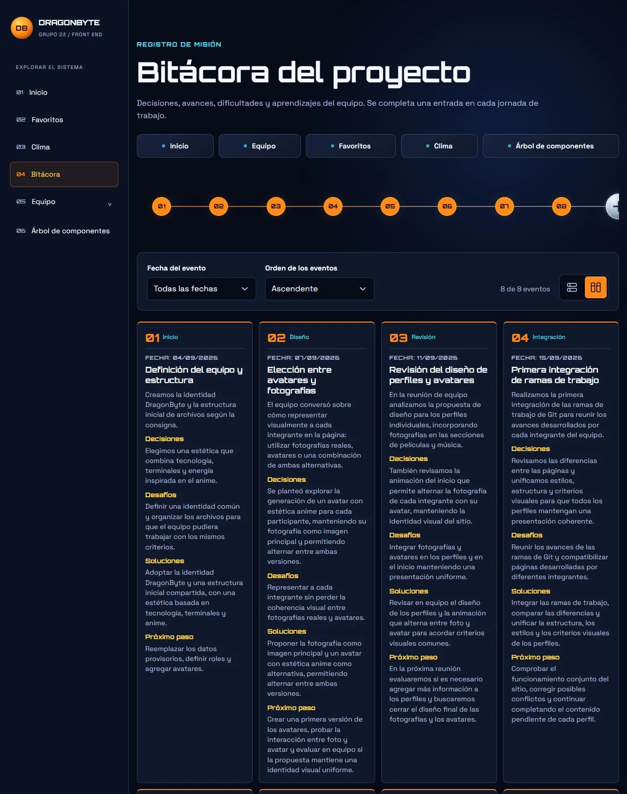](docs/capturas/bitacora-tarjetas.webp)

</details>

<details>
<summary>Ver verificación para agregar una entrada</summary>

**Agregar Evento** abre la verificación de la clave obtenida en el arcade. Las nuevas entradas se guardan únicamente en el navegador utilizado.

[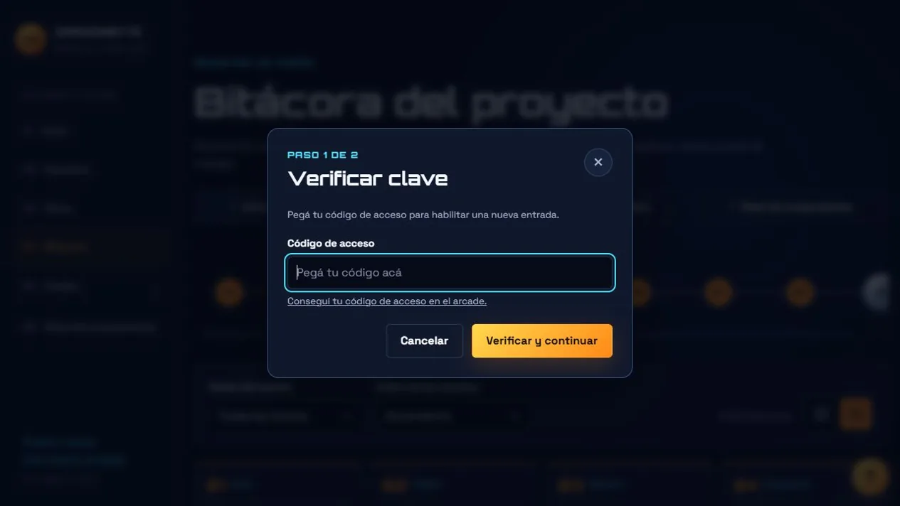](docs/capturas/bitacora-verificacion.webp)

</details>

## Requisitos

- Node.js 22.12 o superior 
- npm, incluido con Node.js.

## Instalación y desarrollo

Desde la carpeta del proyecto:

```bash
npm install
npm run dev
```

Abrir en el navegador la dirección que indique Vite en la terminal.

## Estructura de la aplicación

```text
src/
  main.jsx             Inicia React e importa App y los estilos globales
  App.jsx              Componente principal con React Router y las rutas
  app/pages/           Páginas auxiliares: NoEncontrada y PaginaPendiente
  layout/              Layout compartido, Sidebar y Footer
  modules/             Equipo, favoritos, clima, bitácora, árbol, arcade y desafíos
  styles/global.css    Paleta y estilos comunes
```

`main.jsx` importa directamente `App` desde `src/App.jsx`. Hay un solo componente App y un solo BrowserRouter. El layout muestra cada página a través de Outlet.

La sección `/arbol` representa la jerarquía de componentes, no las carpetas. Sus datos están en `src/modules/arbol/data/componentes.js`; deben actualizarse al cambiar las relaciones entre componentes. Mover App a la raíz de src no cambia esa jerarquía.

## Catálogo local y filtros

La página `/favoritos` consulta por HTTP un único archivo, `public/data/favoritos/catalogo.json`, con **48 registros**. Cada registro tiene identificador único, título, imagen, enlace, categoría (`pantalla` o `musica`) e identificador del integrante que lo recomienda.

El servicio `obtenerCatalogo`, en `src/modules/favoritos/services/favoritos.js`, valida el contenido. La página presenta los registros dinámicamente mediante `TarjetaPortada`, conserva la búsqueda por texto y los filtros por categoría e integrante, e informa cuando no hay resultados. «Limpiar filtros» restablece la lista completa.

Los perfiles conservan sus archivos individuales y su comportamiento. Si se modifica una recomendación en un archivo de perfil, debe actualizarse también su registro correspondiente en el catálogo unificado.

## Favoritos por integrante

Cada perfil carga por HTTP su archivo de `public/data/favoritos/<slug>.json`
mediante `fetch`. Es una fuente estática de solo lectura, sin backend.
El nombre del archivo coincide con el slug del perfil. El `id` es numérico:
1 para Sebastián, 2 para Glaucia, 3 para Ignacio y 4 para Andrea.

```json
{
  "id": 1,
  "NombreIntegrante": "Sebastián",
  "SeriesPeliculas": [
    {
      "id": 1,
      "nombre": "Dragon Ball Z",
      "imagen": "/imagenes/favoritos/peliculas/dragon-ball-z.jpg",
      "url": "https://www.youtube.com/watch?v=hjmAPk1O2Is"
    }
  ],
  "Discos": []
}
```

Las listas contienen objetos, no cadenas de texto. Para agregar un favorito,
añadir un objeto con `id` numérico único dentro de su arreglo, `nombre`, `imagen`
y `url` (enlace de YouTube). El campo opcional `etiquetaEnlace` describe el destino
para lectores de pantalla. Las portadas abren el enlace en una pestaña nueva.
Los enlaces parten del TP1, incluidos discos que enlazan a una canción
y trailers hechos por fans. 

Los componentes están en `src/modules/favoritos/components/`. Cada perfil muestra
dos bloques: Series y películas, y Discos de música.

## Desafíos

Cada perfil incluye el generador de `src/modules/desafios/Desafios.jsx`.
Las cuatro consignas originales están en `src/modules/desafios/data/desafios.json`.
El botón abre el diálogo de las siete esferas; se puede generar otro desafío sin
repetir el anterior, aceptar o cerrar con el botón, Escape o el fondo del diálogo.
El resultado queda visible en el perfil y se reinicia al cambiar de integrante.
Los estilos usan CSS Modules y respetan la preferencia de movimiento reducido.


## Clima de Buenos Aires

La ruta `/clima` consulta las condiciones actuales de una ubicación fija de CABA
(-34.6037, -58.3816) mediante [Open-Meteo](https://open-meteo.com/).
Muestra temperatura y sensación térmica en °C, viento en km/h y la fecha y hora
de los datos en la zona `America/Argentina/Buenos_Aires`. No solicita geolocalización.

La consulta está separada de la presentación en `src/modules/clima/services/clima.js`.
Comparte peticiones simultáneas, reutiliza resultados durante cinco minutos y
limita la espera a doce segundos. Ante errores de red, HTTP o datos inválidos,
la página muestra un mensaje y permite reintentar. Los errores no se almacenan.
La atribución a Open-Meteo permanece visible durante carga, éxito y error.

Pruebas del servicio (sin conexión externa):

```bash
node --test src/modules/clima/services/clima.test.js
```

Después de publicar esta versión, comprobar `/clima` desde la URL del despliegue:
abrir directamente la ruta, confirmar que aparecen las tres mediciones y la hora
de Buenos Aires, probar el reintento sin conexión y abrir el enlace de Open-Meteo.
El proyecto incluye las reescrituras de Vercel necesarias para las rutas de React.
